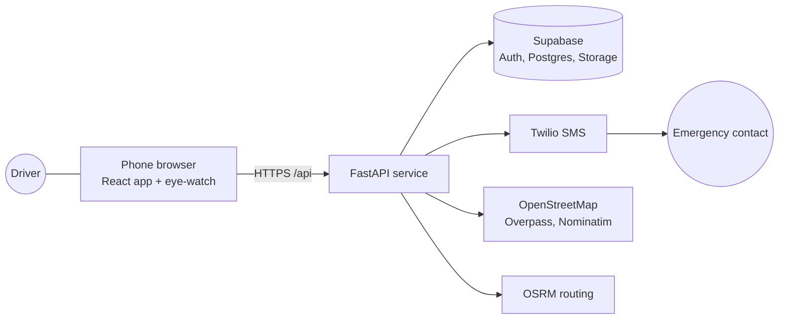

# BUCKL

**Drive awake, arrive safe.** BUCKL is a co-pilot for Malaysian drivers. It checks that you are safe to drive, watches for drowsiness on the trip, escalates to an emergency contact if you stop responding, and explains car warning signs in plain words. The phone sits on the dashboard facing the driver and BUCKL runs in the phone's browser. There is nothing to install.

Built for the Dormathon hackathon, **Track 1: "Predict Early, Decide Better"**. 24 hours, 4 people.

> BUCKL gives a safety indication, not a medical or vehicle diagnosis. It can miss signs. If you feel sleepy, stop and rest.

| | |
|---|---|
| **Design** | [Figma file](https://www.figma.com/design/YQotwkLvWP68ht9GzTbpf0/Dormathon?node-id=0-1) (the source of truth) and the [UX case study](docs/UX-CASE-STUDY.md) |
| **System design** | [Architecture and diagrams](docs/ARCHITECTURE.md) |
| **Design system** | [Tokens, components, motion](docs/DESIGN-SYSTEM.md) |
| **Readiness model** | [`ml/readiness`](ml/readiness/README.md) |
| **API** | [`backend/README.md`](backend/README.md) |
| **Deploy a demo** | [`docs/DEPLOY_DEMO.md`](docs/DEPLOY_DEMO.md) and the [demo script](docs/DEMO_SCRIPT.md) |

---

## The four moments

| # | Moment | What BUCKL does |
|---|---|---|
| 1 | **Before the drive** | Four questions, a 15-second face reading and a 30-second tap test produce **Safe to drive**, **Caution** or **High risk**, with reasons and a plan. High risk offers "Get a ride instead". A safer-route option passes rest stops, fuel and workshops. |
| 2 | **During the drive** | The phone camera watches your eyes (MediaPipe Face Landmarker, on the phone). States are *alert*, *getting tired*, *microsleep alarm* and *can't see your eyes*. Every alert says what to do. Controls lock above 10 km/h. |
| 3 | **When you stop responding** | Alarm and vibration, then "I'm OK" by tap or voice, then a 10-second cancellable countdown, then your chosen contact gets a text with your name, the time and a live location until you are OK. |
| 4 | **Car warning signs** | Photograph a dashboard light and get a plain-words answer with an urgency (*Monitor*, *Book service soon*, *Stop safely now*). The phone times your engine start from its sound and flags a possible weak battery if the crank is slow. Brake wear trends come from your own drives. Workshops are filtered by the problem. |

## What is built

All screens come from the Figma file, 65 frames in total. Screens and routes by section:

| Section | Screens | Routes |
|---|---|---|
| Onboarding | 15 | `/onboarding/*` |
| Drive watch | about 25, including the hidden demo receipt | `/drive/*` |
| Car check | 11 | `/car/*` |
| Trips | 4 | `/trips/*` |
| Profile | 6, plus Help, Terms, Privacy policy and Licences | `/profile/*` |

Passenger mode turns face watching and alarms off. Everything safety-related (alarm, voice prompts, eye watch) works offline once the app has loaded. The emergency text is the one exception and retries until it is sent.

### Not in the MVP

Group or convoy features, tailgating, reading engine temperature from sensors, seizure detection or any medical diagnosis, photo damage walk-around, belt squeal trend, speeding and cornering scores, native iOS or Android builds.

### Known limits

- The pre-drive model is trained on **simulated** drivers (30,000, from published sleep research). It shows that combining signals beats asking alone. It is not real-world accuracy. See [`ml/readiness`](ml/readiness/README.md).
- The **dashboard-light result is a marked demo indication** (with `DEMO_MODE` on, the server returns a scripted finding; with it off, a photo finds nothing) until a model is connected. The start-up check is real signal processing on the phone, but the 2-second threshold is a rule of thumb, not a tested figure. The trip safety score is a simple demo rule, not a model.
- Not available yet: Google sign-in, number-plate scanning, editing a car's details, deleting your data from the app, alarm settings, kilometre reminders.
- Camera, microphone, voice and vibration are tested in an isolated browser. They still need a pass on real phones, iOS Safari especially.
- The Terms and Privacy pages are plain-language summaries without legal review.

---

## How it works, in one picture



Face video never leaves the phone. The browser does the eye tracking, the alarm and the emergency countdown, so the safety features keep working with no signal. The server stores accounts, trips and results, sends the text, and talks to the map services. See [docs/ARCHITECTURE.md](docs/ARCHITECTURE.md) for the full set of diagrams.

## Tech stack

| Layer | Choice |
|---|---|
| Web app | React 19, Vite, TypeScript, Tailwind CSS 4, React Router, Framer Motion |
| Eye tracking | MediaPipe Face Landmarker (`@mediapipe/tasks-vision`), in a web worker, GPU with a CPU fallback |
| Backend | FastAPI on Python 3.11 |
| Data and auth | Supabase (Postgres with row-level security, Auth, private Storage) |
| Emergency texts | Twilio SMS |
| Maps | OpenStreetMap (Overpass, Nominatim) and OSRM |
| Readiness model | Logistic regression (scikit-learn to train, plain Python to serve) |
| Hosting | One Render web service that serves the built web app and the API |

## Repository map

```text
apps/web/            React + Vite + TypeScript mobile web app
  src/screens/       onboarding, drive, car, trips, profile: one folder each
  src/eyewatch/      drowsiness engine, alarm, MediaPipe worker
  src/components/    Figma components and motion pieces
  src/integration/   API client, auth, account data, hooks
  design/            Figma exports used to build and check each screen
  scripts/           token generator, offline cache builder, browser checks
  tests/             unit tests (node --test)
backend/             FastAPI app, SQL schema and migrations, tests
ml/readiness/        training script, notebook, results and the shipped weights
docs/                architecture, UX case study, design system, review evidence
drivesafe-app/       earlier Expo prototype (not part of the web MVP)
server.py, data/     earlier standard-library prototype server (not part of the web MVP)
```

## Run it

You need Node 22 and Python 3.11 or newer.

```powershell
# 1. Web app
cd apps/web
npm ci
npm run dev                 # https on port 5173, reachable from a phone on the same Wi-Fi

# 2. API (new terminal, from the repository root)
python -m venv backend/.venv
backend/.venv/Scripts/python -m pip install -r backend/requirements-dev.txt
Copy-Item backend/.env.example backend/.env      # then fill it in
backend/.venv/Scripts/python -m uvicorn backend.app.main:app --port 8000 --env-file backend/.env
```

Vite proxies `/api` to port 8000. Without Supabase configured, `GET /auth/config` answers `configured: false` and the app shows its signed-out state. The `?preview` links below need no account. For a full signed-in flow with no Supabase at all, run the **standalone demo** instead: `python -m uvicorn backend.app.standalone:app --port 8000`, then sign in as `demo@buckl.test` / `buckl-demo` (see [the demo script](docs/DEMO_SCRIPT.md)).

| Try | Link |
|---|---|
| Component gallery | `/components` |
| Welcome | `/onboarding/welcome?preview` |
| Allow access | `/onboarding/allow-access?preview` |
| Scan a warning light | `/car/scan-a-warning-light?preview` |
| Reading the light | `/car/reading-the-light?preview` |
| Checking the start-up sound | `/car/checking-the-sound?preview` |

**Hidden demo panel.** Every demo shortcut sits behind a triple tap on the logo. They never appear on the real UI. With `DEMO_MODE=1` on the server, the panel can also choose what the next dashboard scan and start-up check return, always labelled a demo. `python -m backend.scripts.seed_demo` fills an account with six weeks of believable trips. See the [demo script](docs/DEMO_SCRIPT.md).

## Test it

```powershell
cd apps/web
npm test                                   # 50 unit tests
npm run build                              # type check, production build, offline cache manifest
node scripts/browser-review.mjs --car      # also: --trips, --profile, --onboarding, --integration, --home
cd ../..
python -m pytest backend/tests -q          # 31 backend tests
```

The browser checks drive an installed Chrome or Edge against a loopback copy of the build and a **fake API**. No database, SMS or live service is touched. `--drive` is an older check that has not been updated for the readiness flow.

## Deploy

One Docker image builds the web app and serves it from FastAPI, so the app and `/api` share one HTTPS address. Follow [docs/DEPLOY_DEMO.md](docs/DEPLOY_DEMO.md). It needs a Supabase project (run `backend/schema.sql`, then `backend/migrations/002_update.sql`) and, only if you want real texts, Twilio credentials. **Do not configure Twilio during a demo unless you have a test recipient.**

## Privacy rules the code follows

- Face video is processed on the phone and never stored or uploaded.
- Audio is recorded only during the start-up check, sent once for analysis and discarded by the backend.
- A dashboard photo is uploaded only when the user takes it.
- Location goes to the emergency contact only after the countdown ends. Otherwise it is used for speed and trip summaries.
- The emergency countdown can always be cancelled.
- Results say "possible" or "may". BUCKL never claims to diagnose.

## Team workflow

[`AGENTS.md`](AGENTS.md) is the shared project brief for people and coding agents. The Figma file is the source of truth. Keep components small and named after the Figma components. UI copy is plain, short British English matching Figma exactly. Ask before adding a dependency.
