# BUCKL architecture and system design

This document explains how BUCKL is built and why. Every number here comes from the code. Where a value is a default that can be tuned, the file that owns it is named.

Diagrams are written in [Mermaid](https://mermaid.js.org/), which GitHub renders in the browser.

**Contents**
1. [Design goals and constraints](#1-design-goals-and-constraints)
2. [System context](#2-system-context)
3. [Containers and responsibilities](#3-containers-and-responsibilities)
4. [Web app architecture](#4-web-app-architecture)
5. [Eye-watch pipeline](#5-eye-watch-pipeline)
6. [Emergency escalation](#6-emergency-escalation)
7. [Pre-drive readiness](#7-pre-drive-readiness)
8. [Trip lifecycle](#8-trip-lifecycle)
9. [Car checks](#9-car-checks)
10. [Data model and security](#10-data-model-and-security)
11. [Deployment](#11-deployment)
12. [Failure modes](#12-failure-modes)
13. [Key decisions and trade-offs](#13-key-decisions-and-trade-offs)
14. [Verification strategy](#14-verification-strategy)
15. [What is not built yet](#15-what-is-not-built-yet)

---

## 1. Design goals and constraints

| Goal | What it forces |
|---|---|
| **Safety features must work with no signal.** A driver on the Karak highway may have none. | Eye tracking, the alarm, voice prompts and the emergency countdown all run **in the phone**. The app and the face model are cached by a service worker. |
| **Face video is private.** | Video is processed on the phone and never stored or uploaded. Only small numbers (blink rate, PERCLOS) leave the device. |
| **Nothing to install.** Drivers will not install an app to try a safety check. | A mobile web app, not a native one. This costs us some sensor access (see [trade-offs](#13-key-decisions-and-trade-offs)). |
| **Never claim a diagnosis.** | Every result says "possible" or "may", carries the line "A safety indication, not a medical diagnosis", and is labelled a demo when a model is a stand-in. |
| **An emergency text must not be sent twice, or lost.** | A cancellable countdown on the phone, idempotency keys, and a delivery ledger on the server. |
| **24 hours, 4 people.** | One repo, one deployable service, managed auth and database (Supabase), and a small model that ships as a JSON file. |

## 2. System context

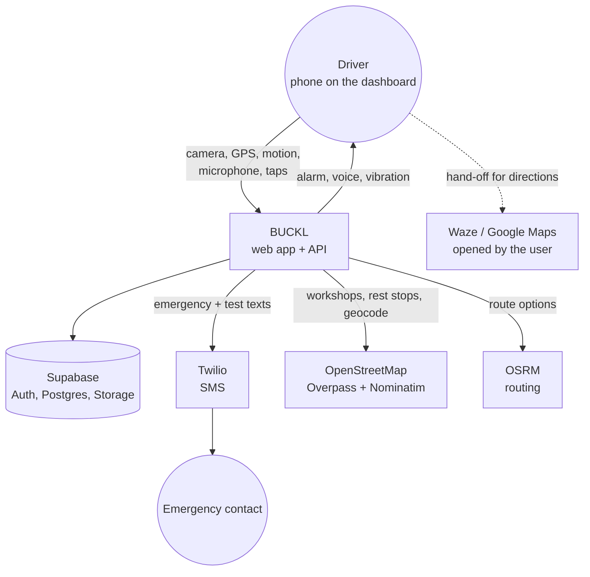

BUCKL never controls the car and never reads engine data. It reads only what a phone browser exposes: camera, microphone, GPS, motion sensors and touch.

## 3. Containers and responsibilities

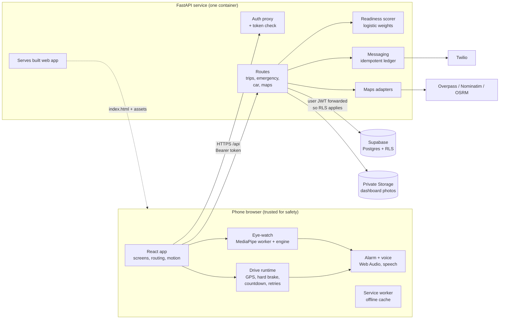

| Container | Owns | Does **not** do |
|---|---|---|
| **Phone** | Eye tracking, alarm, voice prompts, the 10-second countdown, hard-brake detection, local retries | Trust itself with accounts or data storage |
| **FastAPI** | Verifying the user, saving trips and results, scoring the readiness check, sending SMS, calling map services | See face video. Start the countdown (it cannot observe the phone's timer) |
| **Supabase** | Accounts, rows, row-level security, private photo storage | Business logic |
| **Twilio** | Delivering SMS | Knowing whether a handset received it (see [emergency](#6-emergency-escalation)) |

## 4. Web app architecture

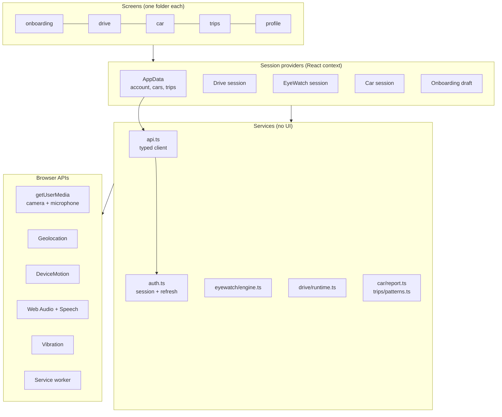

### Layers

| Layer | Folder | Rule |
|---|---|---|
| Screens | `src/screens/<section>` | Mirror the Figma frame names. Read from a provider, render, and call a function. No fetches or timers inside screens. |
| Providers | `AppData`, `drive/session`, `eyewatch/useEyeWatch`, `car/session`, `onboarding/draft` | One owner per kind of state. A response that arrives after the account or trip changed is discarded. |
| Services | `api.ts`, `integration/auth.ts`, `eyewatch/engine.ts`, `drive/runtime.ts` | Plain TypeScript with no React, so they are unit-tested with `node --test`. |
| Components | `src/components` | Figma components with the same props (`Button style/label`, `Option state`, `TabBar active`). |

### Routing and transitions

React Router with one route table per section. Each route has a transition kind in `src/routing/routeMetadata.ts`:

| Kind | Used for |
|---|---|
| `push` | Forward and back inside a flow (slides left or right) |
| `sheet` | The camera, the car sheet and the loading cards (slides up) |
| `fade` | Drive states and loading cards (cross-fade) |
| `tab` | The four tabs (fade in 0.2 s) |

One easing everywhere: `cubic-bezier(0.32, 0.72, 0, 1)`. No bounce. `prefers-reduced-motion` removes movement. Back is **history-aware**: it pops to the earlier entry if there is one, and falls back to a replace with a "back" direction when a screen is opened directly.

### Offline

`scripts/build-offline.mjs` runs after every build. It hashes the whole `dist` folder, writes `sw.js` with the full file list, and names the cache after the hash. Installation completes only when **every** file is cached, so an offline launch always sees one consistent build. Navigation falls back to the cached `index.html`. The face model and local voice files are part of that list.

### Design tokens

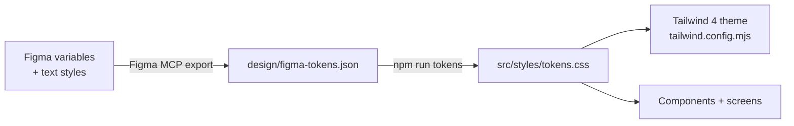

A test (`tests/tokens.test.mjs`) fails if `tokens.css` drifts from the exported JSON. See [DESIGN-SYSTEM.md](DESIGN-SYSTEM.md).

## 5. Eye-watch pipeline

Drowsiness is judged on the phone, frame by frame, with no network.

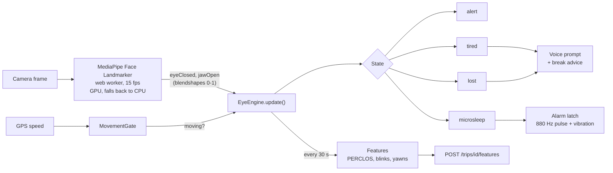

### State machine

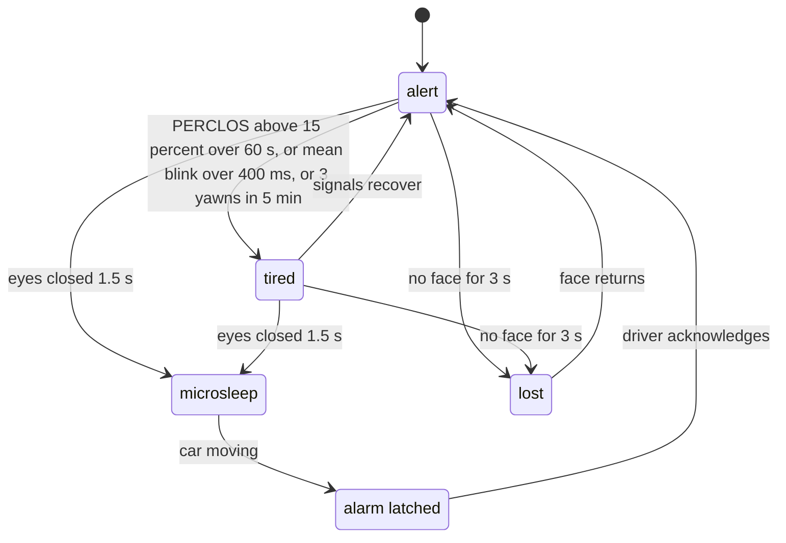

### What the numbers mean

All of these live in `src/eyewatch/engine.ts` (`eyeConfig`) so the engine, the movement gate and calibration agree.

| Setting | Value | Meaning |
|---|---|---|
| `targetFps` | 15 | Inference rate. PERCLOS is weighted by elapsed time, so changes in fps do not skew it. |
| `closedThreshold` | 0.5 | Eye-closed blendshape above this counts as closed. Calibration replaces it per driver. |
| `perclosWindowMs`, `perclosTired` | 60 s, 0.15 | PERCLOS is the share of the last minute with eyes closed. Above 15% means tired, but only after 5 s of evidence. |
| `meanBlinkTiredMs`, `minBlinkMs` | 400 ms, 50 ms | A mean blink over 400 ms means tired. Closures under 50 ms are noise. |
| `yawnMs`, `tiredYawns`, `yawnWindowMs` | 1.5 s, 3, 5 min | Jaw open for 1.5 s is a yawn. Three in five minutes means tired. |
| `microsleepMs` | 1.5 s | Eyes continuously closed this long is a microsleep. |
| `lostMs`, `maxFrameGapMs` | 3 s, 500 ms | No face for 3 s is "can't see your eyes". A gap over 500 ms breaks a closure, so missing frames can never prove a microsleep. |
| `movingSpeed`, `movingMs`, `gpsStaleMs` | 2.8 m/s, 5 s, 6 s | The alarm arms only after about 10 km/h is sustained for 5 s on a **fresh** GPS fix. A parked car does not alarm. |
| `featureIntervalMs` | 30 s | How often features go to the server. |
| `tiredReminderMs` | 10 min | Spacing between repeated "getting tired" reminders. |

### Design rules inside the engine

- **Evidence before judgement.** PERCLOS is ignored until 5 s of valid frames exist, and invalid frames (no face, out-of-range values, time going backwards) never count.
- **Latching.** Once the alarm is on, only the driver's acknowledgement or ending the session turns it off. Reopened eyes or a slower car cannot silence it.
- **Acknowledgement is not enough on its own.** If the eyes were still closed when the driver tapped "I'm OK", they must reopen before the next closure can alarm again.
- **Calibration** (onboarding face scan): 5 s looking at the screen, then at least 2 blinks, to find this driver's open and closed levels. Progress is bound to valid observations, never to a timer.

## 6. Emergency escalation

The phone owns the countdown. The server owns delivery. Neither trusts the other's clock.

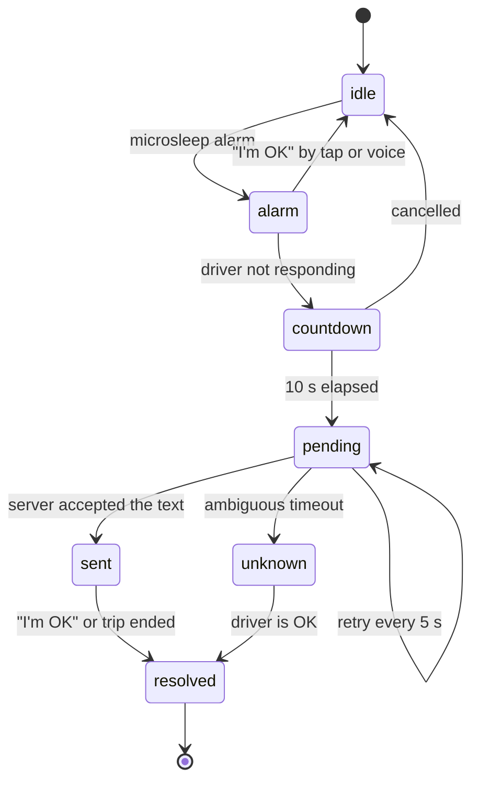

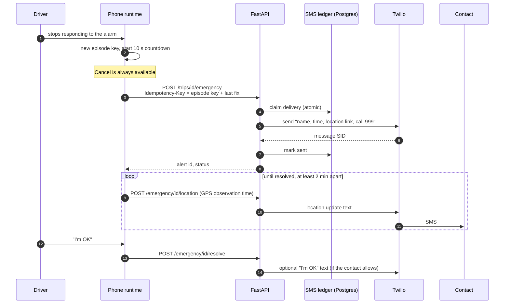

### Why it is built this way

| Risk | Defence |
|---|---|
| The phone retries and the contact gets two texts | Every send needs an `Idempotency-Key`. A ledger row is **claimed atomically** before Twilio is called. |
| The response is lost after the text was sent | `GET /trips/id/emergency?episode_key=` reads the known state without sending again. |
| The driver cancels, but a delayed retry arrives | `POST .../emergency/cancel` with the same key writes a resolved placeholder. A late retry of that key cannot open a new alarm. |
| Timeout with no answer from Twilio | Status is `unknown`, never retried blindly. It needs a look at the Twilio log. |
| Stale GPS | Location updates use the GPS observation time and skip stale fixes. They are at least 2 minutes apart. |
| Privacy | Location is shared only after the countdown, only if `share_live_location` is on, and stops on resolve. |

`sent` means Twilio **accepted** the message and returned a SID. It is not proof that a handset received it, and the UI says so ("submitted").

## 7. Pre-drive readiness

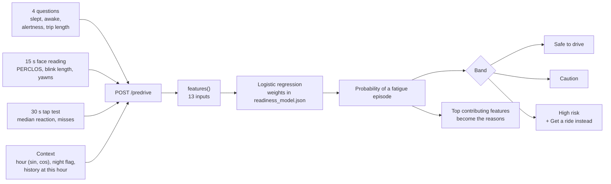

- **Same code trains and serves.** `backend/app/readiness.py` builds the feature row. `ml/readiness/train_readiness.py` imports it, so training and the live app cannot drift apart. Serving needs no ML library: it is a dot product and a sigmoid over weights stored in `readiness_model.json`.
- **Personal pace.** The tap test is compared with the median of the driver's last 20 saved checks. First time, 270 ms.
- **Reasons come from the model.** Each feature's push in log-odds is computed, and the largest ones become the plain-language reasons on the result screen.
- **Honest limits.** Training data is 30,000 *simulated* drivers built from sleep research. Test AUC is 0.84 against 0.66 for "how alert do you feel?" alone. These show the method works. They are not real-world accuracy. The next step is to retrain on the real checks and events the app already saves.

Details, charts and the band table are in [`ml/readiness/README.md`](../ml/readiness/README.md).

## 8. Trip lifecycle

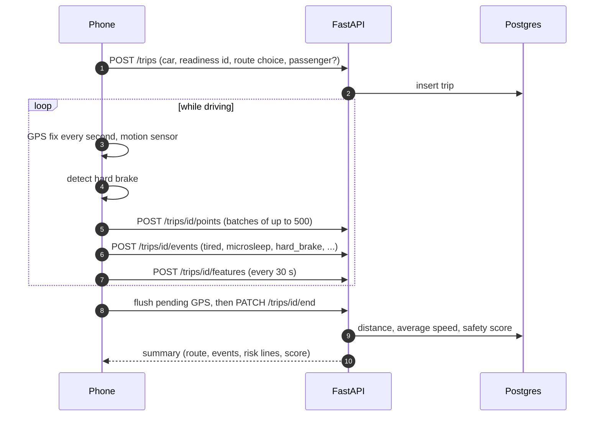

**Hard braking** is detected on the phone from GPS speed plus the motion sensor. A hard brake needs all of: a speed drop of at least 3 m/s² over a window of at most 3 s, a starting speed of at least 20 km/h, a motion-sensor spike (magnitude at least 2 m/s²) in the last 3 s, and at least 5 s since the last one. The motion check stops a noisy GPS fix from looking like a stop.

**Duplicates are harmless.** Points are unique on `(trip, time)` and events on `(trip, event key)`, so a retried batch is ignored. Ended trips reject updates, so the phone flushes before ending.

**Distance and speed.** Distance sums GPS segments. Average speed is distance over *total elapsed time*, including stops. Polylines are `[latitude, longitude]` sorted by time.

**Safety score** is explicitly a demo rule, returned as `score_source: "demo_rule"`:

```text
max(0, 100 - 15 x microsleeps - 5 x tired alerts - 4 x hard brakes - 10 x (high-risk check, drove anyway))
```

**Passenger mode** keeps recording GPS and hard brakes, but ignores face features and monitoring events and rejects escalation.

## 9. Car checks

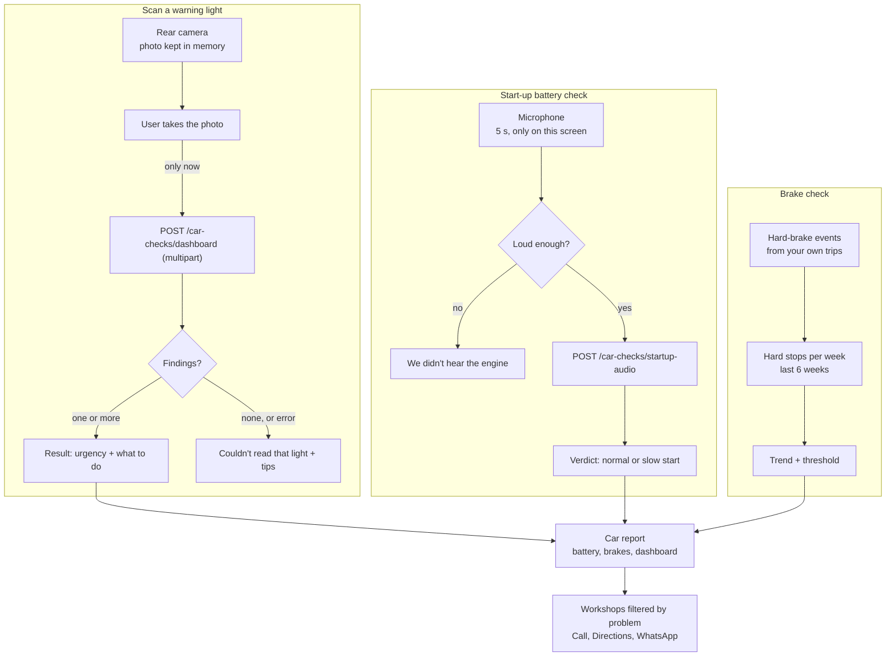

- **A minimum of one second** is enforced on both loading cards so the interface does not flicker, but the card then waits for the real result or failure.
- **Audio** is recorded only while the recorder screen is listening, uploaded once, and discarded by the backend. The phone also measures loudness locally. A silent recording goes straight to the retry screen without an upload.
- **Dashboard photos** go to a private Storage bucket and `photo_url` is a path that needs an authenticated request to view.
- **Dashboard and start-up results are labelled demo indications** (`stub: true`) until models are connected. Missing models return marked stubs, never made-up findings.
- **Brake trend:** hard stops are counted in six one-week buckets. Urgency becomes "Book service soon" when the latest week has at least 3 or the slope is above 0.5 per week.
- **Report building** (`src/screens/car/report.ts`) is pure and tested. It merges the three sources, ranks by urgency, and attaches a typical cost range for battery (RM 200 to 350) and brakes (RM 120 to 250). These ranges are a guide, never a quote.
- **Workshops** rank services that match the problem before distance, include phone, opening hours and Waze or Google Maps links, and come from OpenStreetMap through Overpass. **WhatsApp** opens with the report pre-filled only when the user taps it.

## 10. Data model and security

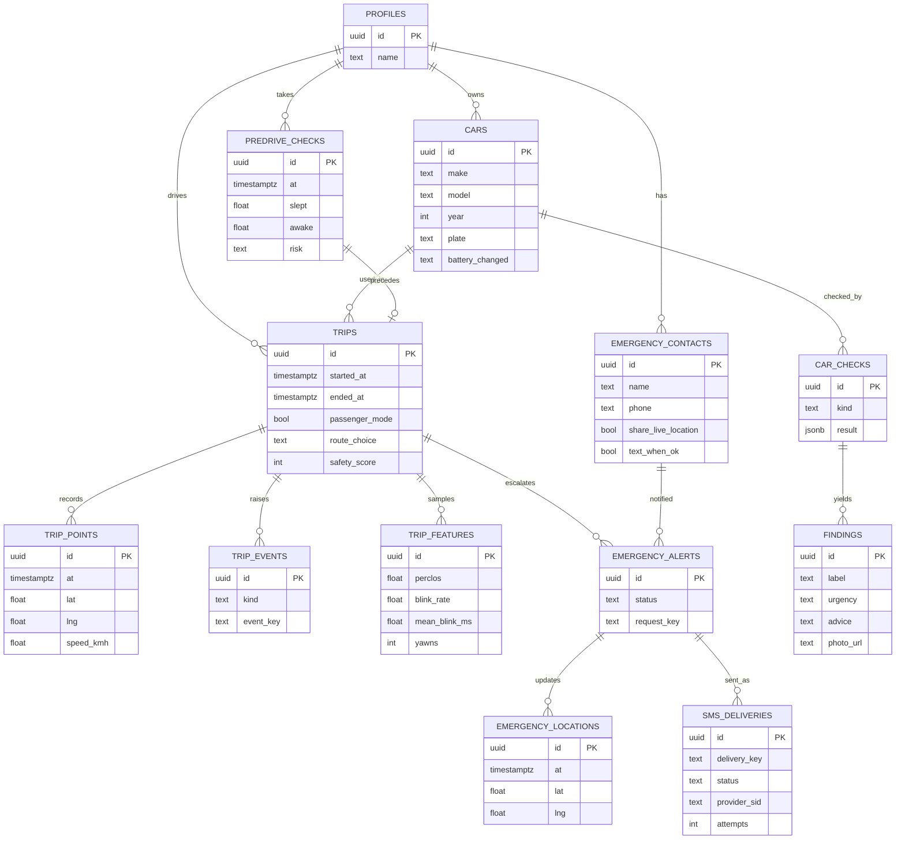

Notes on columns: `phone` is E.164, `trip_events.kind` is one of tired, microsleep, not_responding, lost, yawn, hard_brake, `emergency_alerts.status` is pending, sent, cancelled, failed or unknown, `findings.urgency` is monitor, soon or stop, and `car_checks.kind` is dashboard or startup.

### Security model

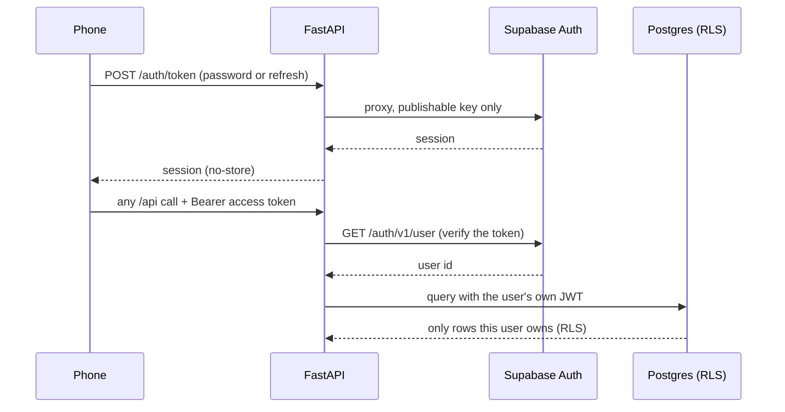

| Control | Detail |
|---|---|
| Token verification | The server asks Supabase to verify each token. It never trusts locally decoded claims. |
| No service-role key | The backend forwards the **user's** JWT to PostgREST, so row-level security protects every table even if the app code has a bug. |
| RLS | On for every table. Child tables check parent ownership. Inserts and updates use `WITH CHECK`. Anonymous privileges are revoked. |
| Missing config | Supabase not configured returns 503. It never silently enables test users or in-memory storage in production. |
| Secrets | Excluded from Git and from the Docker context. |
| Session on the phone | Held in `sessionStorage`, refreshed once for concurrent calls, cleared on a definite refusal. |
| Account isolation | Every provider keys its data on the user id. A late response for a previous account is dropped. |
| Browser storage | Only per-viewer conveniences (the chosen maps app). Never safety state. |

## 11. Deployment

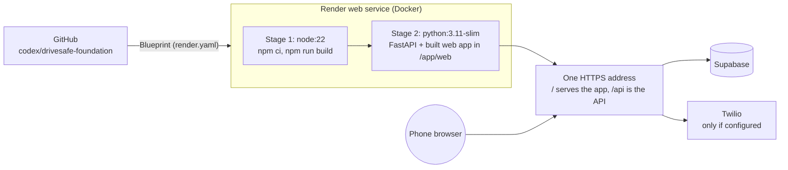

One service means one origin, so there is no CORS to get wrong and the service worker and API share an address. Vite's dev proxy plays the same role locally. The Docker image runs as a non-root user and listens on `$PORT` (default 8080). `/health` reports whether Supabase is configured. See [DEPLOY_DEMO.md](DEPLOY_DEMO.md) for the steps.

## 12. Failure modes

| What fails | What the driver sees | Why it is safe |
|---|---|---|
| No network | Eye watch, alarm, voice and the countdown carry on. The emergency text keeps retrying every 5 s. | Safety logic is local. |
| Camera denied or unplugged | "Can't see your eyes" recovery with a retry. Never silently "alert". | Missing evidence cannot prove an alert state. |
| GPU not available for the model | Falls back to the CPU model automatically. | Same results, lower fps. |
| GPS stale | The alarm does not arm, and speed shows as unknown. Controls stay available. | The app never claims a speed it did not measure. |
| API down during onboarding | A clear error with Reload. | Nothing is faked as saved. |
| Twilio timeout | Status "unknown". No blind resend. | Avoids a duplicate text to a worried parent. |
| Photo unreadable | "Couldn't read that light" with three tips. | No invented result. |
| Microphone silent | "We didn't hear the engine". Nothing uploaded. | No result without usable audio. |
| Account changes mid-request | The late response is discarded. | No data crosses between accounts. |
| Browser pauses the camera in the background | The app asks the driver to return to BUCKL. | Browsers can pause cameras when you switch apps. This is a known limit of a web app. |

## 13. Key decisions and trade-offs

| Decision | Why | Cost |
|---|---|---|
| **Mobile web app, not native** | Nothing to install, one codebase, judges can open a link. | iOS Safari can pause the camera in the background and offers no Do Not Disturb control. We prompt instead. |
| **MediaPipe Face Landmarker blendshapes** | On-device, free, fast. Eye-closed and jaw-open scores are already normalised. | Quality depends on light and angle. We calibrate per driver and refuse to judge without evidence. |
| **PERCLOS plus blink length plus yawns** | PERCLOS is a long-standing fatigue measure in driver-monitoring research. Three signals are harder to fool than one. | Thresholds are research-informed defaults, not tuned on real drivers. |
| **Countdown on the phone** | Must work offline and cannot depend on a server clock. | The server cannot see the countdown, so it trusts the phone to call `/emergency` only after it ends. |
| **Idempotency keys and a delivery ledger** | A retried request must never send two texts. | More code and one extra table. |
| **Logistic regression shipped as JSON** | Explainable, tiny, and the API needs no ML library. Gradient boosting scored the same (AUC 0.84). | Cannot capture complex interactions. We did not need them. |
| **Simulated training data** | No labelled real drives exist yet. | Reported numbers are about the method, not real-world accuracy. Said everywhere it is mentioned. |
| **User JWT, not a service-role key** | RLS stays the last line of defence. | Every query must be expressible under RLS. |
| **One Render service** | Fast to deploy, one origin. | The web and API scale together. Fine for a demo. |
| **Figma as source of truth, exported tokens** | Design and code cannot silently drift. A test catches drift. | Needs the Figma MCP to refresh. |
| **Demo shortcuts behind a triple tap** | The real UI stays honest. | Presenters must know the gesture. |

## 14. Verification strategy

| Level | What | Where |
|---|---|---|
| Unit | Typed API client and token refresh, eye engine and calibration, microphone loudness, drive runtime (hard brake, countdown, retries), voice, tokens, transitions, car report and trip pattern logic | `apps/web/tests` (50 tests) |
| API | Auth, readiness scoring, trips, emergency idempotency, maps adapters, geocode limits | `backend/tests` (31 tests, in-memory storage and mocked HTTP) |
| Browser | Real Chrome against a built copy and a fake API: layouts at 430, 390 and 360 px, no horizontal overflow, no broken images, Back behaviour, route transitions, hidden demo, signed-in flows | `apps/web/scripts/browser-review.mjs` |
| Visual | Figma screenshot against the built screen, side by side | [`docs/assets/figma-vs-build`](assets/figma-vs-build) and `docs/review` |
| End to end (fake) | A scripted trip through readiness, GPS, two hard brakes, a completed countdown, mocked SMS and a summary | `python -m backend.scripts.fake_trip` |

Nothing in the automated checks touches a live database, SMS provider or map service.

## 15. What is not built yet

- Retraining the readiness model on real checks and in-drive events.
- Trained models for dashboard lights and the start-up sound (today they return marked stubs).
- Server endpoints for editing a car, deleting an account's data, and alarm preferences.
- Push or scheduled reminders (for example "remind me in 1,000 km").
- Number-plate scanning, Google sign-in, and place names for trips (needs reverse geocoding).
- A pass on real phones, iOS Safari first.
- A legal review of the Terms and Privacy pages.
