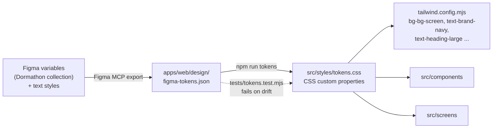

# BUCKL design system

The visual language of BUCKL, how it is stored in Figma, and how it reaches the code. The reasoning behind these choices is in the [UX case study](UX-CASE-STUDY.md).

**Source of truth:** the [Figma file](https://www.figma.com/design/YQotwkLvWP68ht9GzTbpf0/Dormathon?node-id=0-1). The "Components" frame holds the building blocks and the "Motion" frame holds every animated part.

## 1. From Figma to code

1. Change a variable in Figma.
2. Refresh `design/figma-tokens.json` through the Figma MCP.
3. Run `npm run tokens` in `apps/web` to regenerate `src/styles/tokens.css`. Do not edit that file by hand.
4. `npm test` fails if the CSS no longer matches the JSON.

Values that Figma has not bound to a variable (for example the Drive screens' gradient stops and some shadows) are written once as named CSS custom properties at the top of the section's stylesheet, with a comment saying which frame they were read from.

## 2. Colour

### Light screens (parked)

| Token | Value | Use |
|---|---|---|
| `bg/screen` | `#FCFCFE` | Page background |
| `bg/card` | `#FFFFFF` | Cards, sheets, secondary buttons |
| `bg/field` | `#F2F3F5` | Inputs, chips, dividers |
| `bg/tint` | `#EEF1F7` | Notes, icon tiles, selected rows |
| `line/default` | `#E8EAED` | 1 px card borders |
| `text/primary` | `#282828` | Body and headings |
| `text/secondary` | `#797979` | Supporting copy |
| `text/tertiary` | `#A6A6A6` | Placeholders, captions |
| `text/inverse` | `#FFFFFF` | Text on navy and dark |
| `brand/navy` | `#1B2A4E` | Primary buttons, logo, selected state |

### Drive screens (dark)

| Token | Value | Use |
|---|---|---|
| `drive/bg` | `#0B1220` | Page background |
| `drive/card` | `#141E30` | Cards |
| `drive/line` | `#22304A` | Card borders |
| `drive/text-secondary` | `#95A0B3` | Supporting copy |
| `drive/accent` | `#3BC48D` | "Alert" ring, scan line, live status |

### State colours

| State | Strong (text, icon) | Soft (background) | Dot |
|---|---|---|---|
| Success | `#239A6C` | `#E3F3EC` | same |
| Warning | `#B86E00` | `#FCF0DA` | `#E8A317` |
| Danger | `#EF4F44` | `#FDE7E5` | same |

**Rule:** colour always means state, and a state always has a word as well. Text on a soft background uses the strong colour so it stays legible.

## 3. Typography

One family, **Inter** (SIL Open Font Licence, served locally from `public/fonts`, so it works offline).

| Style | Size | Weight | Used for |
|---|---|---|---|
| Heading / Display | 44 | 700 | Countdown and timer numbers |
| Heading / Large | 28 | 700 | Screen titles |
| Title / Medium | 18 | 600 | Card and section titles, buttons |
| Body / Regular | 16 | 400 | Subtitles and paragraphs |
| Body / Strong | 16 | 600 | List titles |
| Body / Small | 14 | 400 | Descriptions |
| Body / Small Strong | 14 | 600 | Inline emphasis, tab labels, states |
| Label / Small | 12 | 500 | Captions, chart labels |
| Numeric / Large | 24 | 700 | Stat numbers |
| Button | 18 | 600 | All buttons |

Use the generated classes (`text-heading-large`, `text-body-small-strong`). Screens never set a font size directly. Line heights are 1.4 for running text and `normal` for headings and labels.

## 4. Shape, size and spacing

| Thing | Value |
|---|---|
| Frame | 430 x 932 (a maximum width of 430 in code) |
| Screen gutter | 20 px |
| Footer clearance | 34 px from the bottom (or the safe area, if larger) |
| Primary and secondary button | 56 px high, 18 px radius |
| Icon button | 40 px round |
| Input | 56 px high, 16 px radius |
| Card | 18 px radius, 1 px `line/default`, soft shadow `0 6px 16px rgba(0,0,0,.04)` |
| Icon tile | 44 px (14 px radius) in rows, 36 px in settings |
| Floating tab bar | 56 x 48 px tabs, 26 px radius, drop shadow |
| Section gap | 16 to 20 px |

## 5. Components

Props are **the same names as in Figma**, so a designer and a developer talk about the same thing.

| Component | Props | Notes |
|---|---|---|
| `Button` | `style` Primary, Secondary, Light, Outline, Drive. `label`. `state` Default or Pressed | Darkens while pressed. Scales to 0.98. |
| `IconButton` | `icon` Back, Close, Share. `theme` Light or Dark | 40 px round. |
| `TabBar` | `active` Home, Trips, Car, Profile. `onChange` | Floating pill. The parent decides where each tab goes. |
| `Input` | `state` Placeholder, Filled, Focused. `text` | Focus shows a 1.5 px navy ring. |
| `Option` | `state` Default or Selected. `title`. `description` | A radio-style row. Uncontrolled by default. |
| `BrandMark` | `theme` Navy or White. `version` On light, On dark or Mono | The car-front mark. |
| `AppFrame` | `theme` Light or Dark. `footer` | Pins the footer 34 px from the bottom. |

Section-specific pieces keep the Figma name: `Card`, `DetailRow` and `LoadingCard` (Car, where `LoadingCard` is the dots-and-two-lines card shown over the waiting screen), `RowList` (Profile), `Field` and `Choice` (Onboarding), `DriveFrame` (Drive).

### Interaction states

| State | Behaviour |
|---|---|
| Pressed | Background darkens (`--button-<style>-pressed`) and the button scales to 0.98 in 0.12 s |
| Dialogs | Sheets and the camera use native `<dialog>`, which traps focus, and focus returns to where the driver was on close |
| Disabled | A disabled button cannot be pressed. Where it matters the screen says why (for example End drive is disabled above 10 km/h) |
| Selected | Navy 1.5 px border and a check, never colour alone |

## 6. Motion

All animated pieces are defined once in Figma's "Motion" frame and implemented in `src/components/motion`.

| Piece | What it shows |
|---|---|
| `LoadingDots` | Three dots in sequence. Light or dark tone. |
| `ProgressBar` | A navy bar over 2.2 s for the loading screen |
| `LiveDot` | A pulsing dot ("Listening", "Eyes tracked"). Green or red. |
| `ScanRing` | The face-reading ring that fills as valid observations arrive |
| `Countdown` | The 10-second emergency ring and number |
| `AlarmFlash` | A red wash behind the alarm |
| `ScanLine` | The green line that sweeps the camera viewfinder |
| `TapDot` | The dot in the tap test, with a halo |
| `Waveform` | 36 bars. Driven by the **real microphone level** when a stream is given, and a looping idle animation otherwise |

### Rules

- **One easing:** `cubic-bezier(0.32, 0.72, 0, 1)`. No bounce, no spring.
- **Transitions:** push (forward and back), sheet (up), fade (Drive states, loading cards), tab (0.2 s fade).
- **Loading cards** appear over the screen that is waiting and stay at least 1 s.
- **Reduced motion:** movement is removed, and opacity or colour carries the change.
- The microphone meter reads loudness only. Nothing is recorded by the visual.

## 7. Assets

- **Icons and illustrations are Figma exports**, placed in the same slot at the same size. Do not redraw them. Each section has its own `public/assets/<section>` folder.
- The **car illustration** is one asset, reused at several sizes (Home, Welcome, Car check, empty states at 35 percent opacity).
- Sample artwork for the camera preview (the dashboard) is assembled from the exported vectors and shown **only** in `?preview`, never to a real driver.

## 8. Writing rules

Short, plain British English matching the Figma text exactly. Lead with the action, say "possible" or "may" for anything that is a judgement, and never claim a diagnosis. Details and examples are in the [content design table](UX-CASE-STUDY.md#8-content-design).

## 9. Adding or changing something

1. Design it in Figma first, using variables and the existing components.
2. If a new variable is needed, add it to the Dormathon collection, refresh the tokens and regenerate.
3. Name the component after the Figma component and give it the same props.
4. Build the screen at 430 px, then check 390 and 360 for overflow.
5. Save a Figma-against-build screenshot, and run `node scripts/browser-review.mjs --<section>`.
6. Ask before adding a dependency.
