# BUCKL UX case study

How we went from "drowsy driving is dangerous" to a phone on a dashboard that says the right thing at the right moment, and the thinking behind each design choice.

| | |
|---|---|
| **Product** | BUCKL, a driving co-pilot for Malaysia |
| **Brief** | Dormathon Track 1, "Predict Early, Decide Better" |
| **Team and time** | 4 people, 24 hours |
| **Scope** | Product design, UX writing, the Figma file, and turning it into a working mobile web app |
| **Prototype** | [Figma file](https://www.figma.com/design/YQotwkLvWP68ht9GzTbpf0/Dormathon?node-id=0-1) (65 frames, 430 x 932) |
| **Companion docs** | [Architecture](ARCHITECTURE.md) and [Design system](DESIGN-SYSTEM.md) |

> **A note on evidence.** We did not run interviews or usability tests in 24 hours, and this document does not pretend we did. Where something is an assumption, it says so and [section 10](#10-what-we-would-test-next) turns it into a test. The fatigue science we lean on is cited in [`ml/readiness`](../ml/readiness/README.md).

---

## 1. The problem

A tired driver is the worst judge of how tired they are. Research on sleep loss shows people under-rate their own sleepiness after short sleep (Van Dongen 2003). By the time the eyelids drop, there are only a few seconds left.

So "just ask the driver how alert they feel" is a weak signal. In our simulated test, self-report alone scored an AUC of 0.66 against 0.84 when combined with a tap test and a face reading.

Three further things make the problem specific to the people we build for:

1. **Long, late drives are normal in Malaysia.** Balik kampung, outstation trips and late drives home from campus or work are routine. The risky drive is usually not a one-off. It is a Tuesday night.
2. **The people who care are not in the car.** The parent who waits up cannot do anything about a microsleep, but they can act if they are told early.
3. **Cars fail quietly too.** A weak battery or an ignored warning light turns a normal trip into a roadside emergency, often at night.

### Who it is for

| Persona (assumed, not interviewed) | Situation | What they need from BUCKL |
|---|---|---|
| **Aiman, student** | Drives home from campus after 11 pm. Under-slept. Phone is already on a dashboard mount for maps. | A quick honest check, a gentle nudge, and mum told if he stops responding. |
| **Pn. Halimah, balik kampung driver** | 4 hours on the highway, with kids in the car. Not tech-confident. | Big buttons, plain words, and an alarm that does not need reading. |
| **Kumar, e-hailing driver** | Many hours a day. Cannot be locked out of his phone. | Quiet when fine, loud when needed, and no nagging. |
| **A passenger** | Using the phone for maps while someone else drives. | To switch the watching off so it never alarms for them. |

## 2. The idea in one sentence

> **Check you are safe to drive, watch for danger on the trip, and help you act when you or your car show warning signs.**

We cut the product into four moments, because a driver's needs change completely at each one:

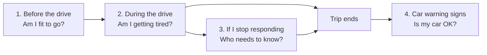

| Moment | Driver's state of mind | Design stance |
|---|---|---|
| Before | Calm, deciding | Be honest and specific. Explain *why*, then give a plan. |
| During | Eyes on the road, hands busy | Say almost nothing. Big targets. One action per alert. |
| Emergency | Possibly impaired | Loud, simple, and always cancellable. |
| Car | Parked, curious or worried | Plain words and a clear urgency. Never a diagnosis. |

## 3. Design principles

Each principle is something a reviewer can check in the build.

| # | Principle | How it shows up |
|---|---|---|
| 1 | **Say what to do, not just what is wrong.** | Every alert ends in an action: "Take a 15-minute break at the next safe stop." Every result has a plan or a next step. |
| 2 | **Calm when fine, loud when not.** | The Driving screen is a single ring and one word, "Alert". Nothing else competes until something is wrong. |
| 3 | **A driver's hands are not free.** | Dark, high-contrast Drive screens. Controls lock above 10 km/h. Large buttons. "I'm OK" works by voice. |
| 4 | **Never claim to diagnose.** | Results say "possible" or "may". The readiness result carries "A safety indication, not a medical diagnosis." |
| 5 | **Always a way out.** | The emergency countdown can be cancelled at any time. Passenger mode turns the watching off. |
| 6 | **Private by default, and say so.** | Face video never leaves the phone. Permission screens and the privacy page say exactly what is used and when. |
| 7 | **Honest about limits.** | Demo results are labelled. Features we have not built say "isn't available yet" instead of pretending. |
| 8 | **Short, plain, British English.** | "Take a break", not "Fatigue mitigation recommended". |

## 4. Information architecture

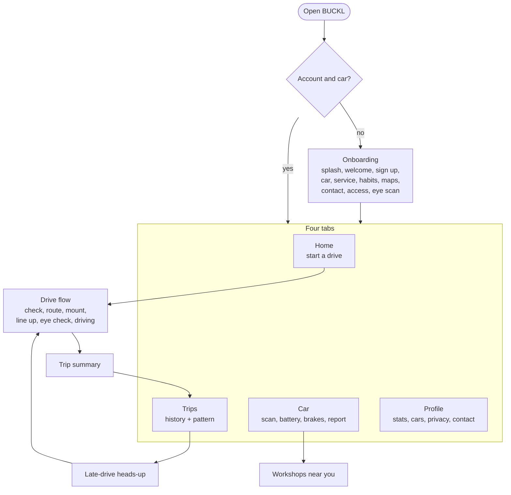

The tab bar appears only when the driver is parked. The moment a drive starts the app switches to a dark, full-screen mode with no tabs, so there is nothing to tap by accident.

## 5. The journey, screen by screen

### 5.1 Onboarding: earn trust before asking for anything

```mermaid
flowchart LR
  s["Splash"] --> l["Loading"] --> w["Welcome"] --> su["Sign up"] --> c["What's your car"]
  c --> cd["Car details"] --> sv["Service and<br/>condition"] --> hd["How you drive"]
  hd --> mp["Which maps app"] --> ec["Emergency contact"] --> aa["Allow access"]
  aa --> fi["Face scan intro"] --> fs["Face scan"] --> as["All set"]
```

Fifteen screens sounds like a lot, so we designed each to feel small:

- **A step bar ("Step 2 of 4")** shows how far there is to go, and the four steps are about *the driver's world*: car, habits, maps, safety.
- **The car comes first** and starts with a search ("Perodua Myvi"), not a form. The model prefills engine, gearbox and fuel and says "Check the gearbox is right. It changes how a healthy engine sounds", which explains why we ask.
- **Battery age is a three-option question** with a reason ("Batteries wear out faster in our heat. This helps the start-up check.") instead of a free-text box.
- **The emergency contact is explained before it is requested.** The card "Only when it matters" says it alerts them only after 10 unanswered seconds, and that the driver can cancel.
- **Permissions are shown as five plain rows**, each with *why* ("Camera: Watches your eyes while you drive."). A line at the top says "Video and audio never leave your phone". Do Not Disturb says "Turn on" because a browser cannot switch it on for you.
- **The face scan** teaches BUCKL *this driver's* normal blink, so a naturally sleepy-looking face is not treated as an emergency.

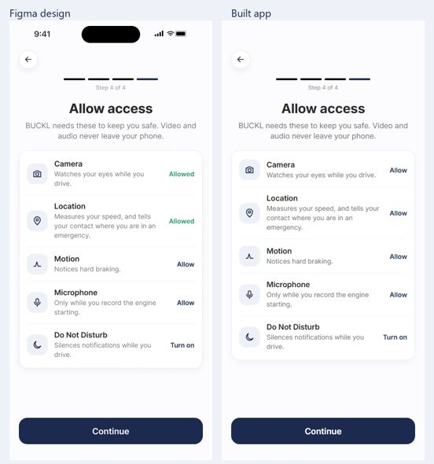

### 5.2 Before the drive: a check that explains itself

The readiness check is four short questions, a 15-second face reading and a 30-second tap test. We kept it under a minute and made every step say what it is for.

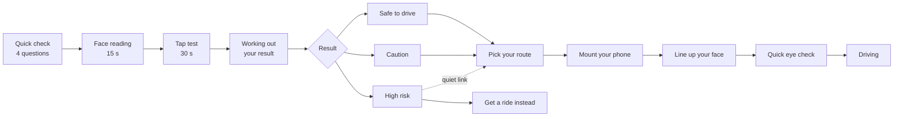

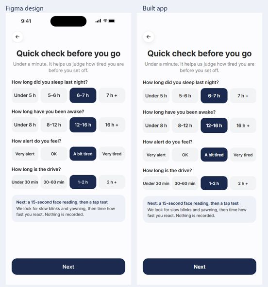

Decisions worth explaining:

- **Chips, not a slider.** "Under 5 h, 5-6 h, 6-7 h, 7 h +" is faster to tap and avoids false precision. The model buckets answers the same way.
- **A tinted note card ("Next: a 15-second face reading, then a tap test... Nothing is recorded.")** sets expectations for the two physical tests.
- **High risk is not a dead end.** The primary button is **Get a ride instead**. "Drive anyway" exists as a quiet link, with a safety disclosure, because an app that locks you out gets deleted. A warning the driver respects beats a gate they route around.
- **Reasons before the plan.** Each result lists the evidence in plain words (for example slow taps, long blinks, hours awake), then says what to do.
- **Passenger mode** sits on the mount screen as a quiet link, not as a setting.

### 5.3 During the drive: say almost nothing

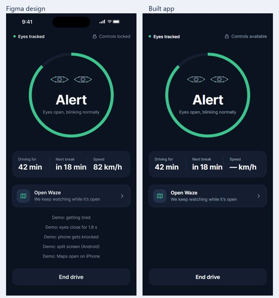

The Driving screen is deliberately sparse:

- **One ring and one word.** "Alert" in white on near-black. The ring is the glanceable status, since a driver can read it in under a second.
- **Three facts in one card:** time driving, time to the next break, and speed. The break timer exists so a "getting tired" message is never a surprise.
- **Open Waze** is a card, because most drivers navigate on the same phone. BUCKL keeps watching while the maps app is open and tells you so ("We keep watching while it's open").
- **End drive** is the only button, and it is disabled above 10 km/h.

When the eyes say tired, the screen changes state with a cross-fade, never a push, so nothing seems to "move" toward the driver:

| State | Screen | Sound | What it says and offers |
|---|---|---|---|
| Alert | Green ring, "Alert" | none | nothing |
| Getting tired | Amber card with the evidence ("Slow blinks, 3 yawns in 10 min") and the next safe stop | Spoken prompt | **"Take a 15-minute break"**, button "Remind me in 10 min" |
| Microsleep | Full-screen alarm | Loud tone and vibration | **"Pull over and rest"**, "The alarm keeps sounding until you tap below or say I'm awake", button "I'm awake" |
| Can't see your eyes | Recovery layout | Spoken prompt | "Your phone may have moved, or your head is turned away. Adjust it when it's safe." Watching restarts on its own when your eyes are back in view. |
| Maps open and tired | Warning card over the maps view | Spoken prompt | Break action and a way back to BUCKL |

Frames for a split screen and an iPhone maps view were designed and then **deliberately skipped**. The state that matters is "still watching while a maps app is open", and that is covered by two screens.

### 5.4 When the driver stops responding: always cancellable

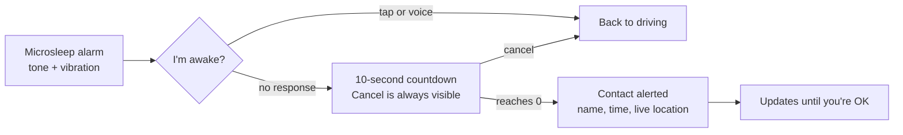

- **Three steps, each with one big target.** The alarm ("I'm awake"), then the countdown ("I'm OK, cancel"), then the contact is told. Both can be answered by voice. The countdown screen also has **Call 999** and "Your location", ready to read out, for a driver who is hurt.
- **The countdown is a number in a ring**, readable at arm's length and without words.
- **Honest status text.** The contact screen says what is true: "pending" while the text is being sent, "sent" when the provider accepts it, and "couldn't confirm" when that is the case. It never says "delivered" because we do not know that.
- **The receipt.** A hidden demo screen, "What Mum receives", shows the exact text so judges and teammates can see what the contact sees. It never sends anything.

### 5.5 After the drive and when parked

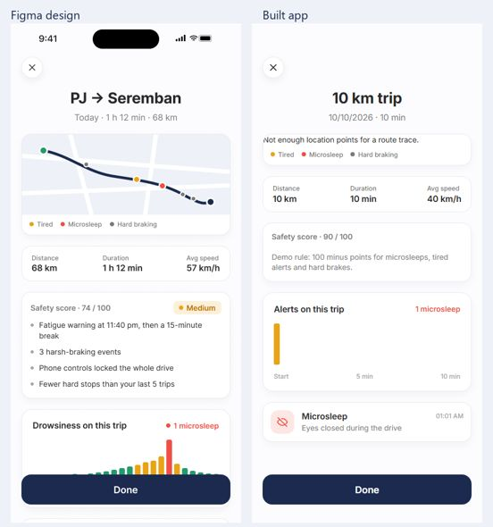

**Trip summary.** Route map, distance, duration, average speed, a safety score with a label (for example Medium) and plain "trip risk" lines such as "Fatigue warning at 11:40 pm, then a 15-minute break". The score is explained as a demo rule, so it can be argued with.

**Trips** turns many drives into one insight: "You get tired faster at night", drawn as eight time-of-day bars with the late-night ones in amber. **When you get tired** expands it. **Late-drive heads-up** appears before a risky late drive and offers "Do the 1-minute check" or "Not tonight".

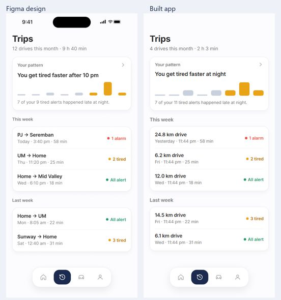

### 5.6 Car check: a mechanic's explanation, not a fault code

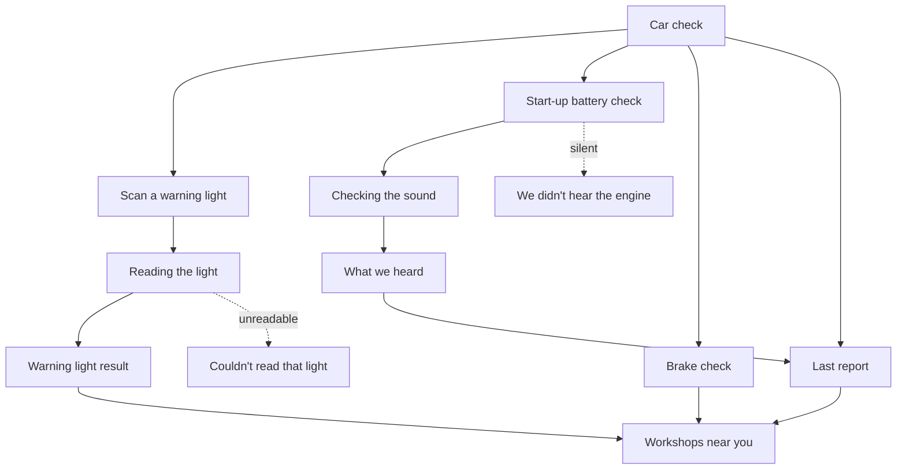

- **Three checks, each with its time cost** ("10 sec", "5 sec", "From your drives"). People start things they can finish.
- **Urgency is a colour and three words:** Monitor (green), Book service soon (amber), Stop safely now (red). The result card leads with the urgency, then "What to do" in numbered steps.
- **Every failure has a screen.** A blurry photo and a silent recording each get their own page with "Try this" tips, because the failure paths are where a first-time user decides whether to trust the app.
- **Workshops are filtered by the problem** (Cooling, Battery, Brakes, Tyres, Fuel), with **Call** and **Directions** one tap away. **Send report on WhatsApp** forwards the findings so the workshop knows what is coming. It sends nothing until the user taps.

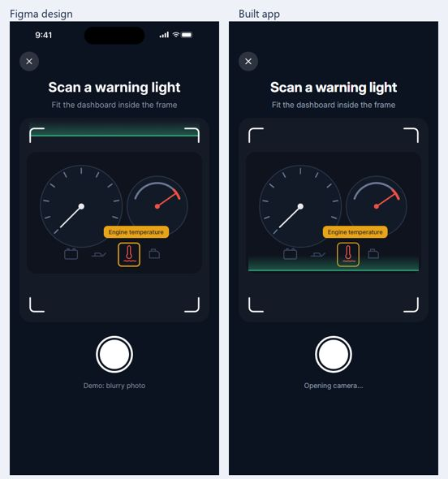
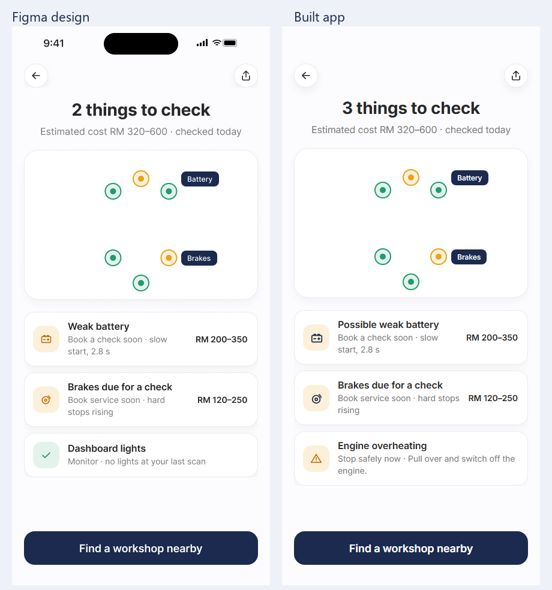

### 5.7 Profile: trust and control

Profile holds the settings a driver needs to *feel safe*: emergency contact (with "Share my live location" and "Text them when I'm OK" toggles), the eye profile re-scan, and a Privacy and legal page that leads with "BUCKL is a driving aid... isn't a medical device". Rows explain themselves ("Only if needed", "On your phone").

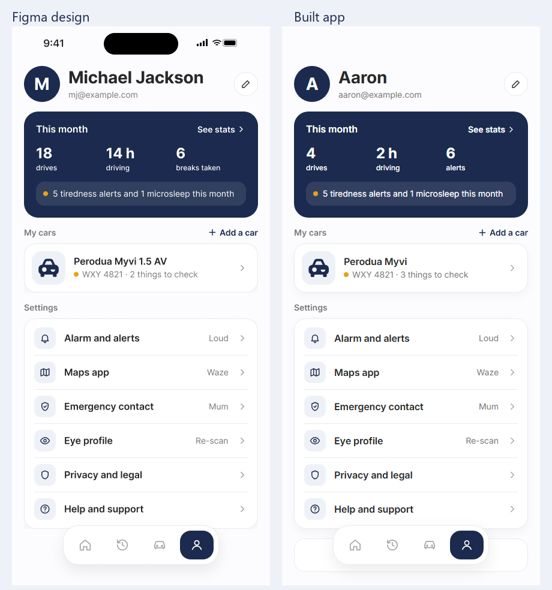

## 6. Visual design

| Decision | Reason |
|---|---|
| **Two themes by context.** Light for parked screens (`#FCFCFE` page, white cards, `#E8EAED` border). Dark for Drive screens (`#0B1220` page, `#141E30` cards, `#3BC48D` accent). | A dark dashboard-mounted screen is less glaring at night and keeps the ring readable. Parked screens stay friendly and familiar. |
| **Brand navy `#1B2A4E`** for primary actions and the logo mark. | Trustworthy and calm. Reserved so red and amber keep their meaning. |
| **Colour means state.** Success `#239A6C`, warning `#B86E00` (dot `#E8A317`), danger `#EF4F44`. Each has a soft tint for backgrounds. | A driver learns one vocabulary. Text on a tint always uses the strong colour to stay legible. |
| **Inter, 6 text styles.** 44 display, 28 heading, 18 title, 16 body, 14 small, 12 label, with semibold variants for emphasis. | One family keeps things quiet. Sizes are generous because the phone is 60 cm away. |
| **430 x 932 frames, 20 px gutters, 56 px buttons, 18 px radius.** | Matches a modern phone. 56 px buttons are a comfortable target even with a thumb on a mount. |
| **Illustration over photography.** One car illustration, used in Home, Welcome and the empty states. | It makes the product feel finished with no photo shoot, and it works at every size. |

Full tokens and components are in [DESIGN-SYSTEM.md](DESIGN-SYSTEM.md).

## 7. Motion

Motion is used to explain, never to decorate.

| Principle | Implementation |
|---|---|
| **iOS-style transitions** | Push left or right for forward and back. Bottom sheets and the camera slide up. Drive states and loading cards cross-fade. Tabs fade in 0.2 s. |
| **One easing everywhere** | `cubic-bezier(0.32, 0.72, 0, 1)`. No bounce, because nothing in a car should bounce. |
| **Buttons darken while pressed** | Instant feedback without moving the layout. |
| **Animated parts live in a "Motion" frame** | Loading dots, progress bar, scan ring, countdown, alarm flash, scan line, tap dot and a waveform driven by the real microphone level. Screens reuse them instead of redrawing. |
| **Loading cards sit over the screen that is waiting** | "Reading the light..." sits on the camera and "Checking the start-up sound..." sits on the recorder. The driver sees what is happening and where they will land. A minimum of one second stops a flash. |
| **Reduced motion** | Honoured. Movement is removed and state changes still read clearly. |

## 8. Content design

We wrote the copy as part of the design, because on a dashboard words are the interface.

| Do | Don't | Example |
|---|---|---|
| Lead with the action | Lead with the problem | "Take a 15-minute break at the next safe stop." |
| Say "possible" or "may" | State a diagnosis | "Possible weak battery" |
| Give the reason in one line | Leave the driver guessing | "Batteries wear out faster in our heat." |
| Use real places and units | Be abstract | "RM 200 to 350", "1.2 km", "open until 7 pm" |
| Name the failure kindly | Blame the user | "We didn't hear the engine. It was too quiet, or there was too much noise around." |
| Keep it British | Mix spellings | "Colour", "tyres", "licences" |

The product is always **BUCKL**, the tagline is **"Drive awake, arrive safe"**, and the disclaimer is always the same sentence.

## 9. Accessibility and inclusion

- **Targets.** 40 px icon buttons and 56 px primary buttons. Locked controls while moving.
- **Voice.** Spoken prompts and "I'm OK" by voice for when hands cannot leave the wheel.
- **Colour is never the only signal.** Every state has a word as well ("Stop safely now", "Normal", "Check").
- **Contrast.** Dark Drive screens use white on `#0B1220`. Strong state colours are used for text on tints.
- **Motion.** `prefers-reduced-motion` is respected.
- **Language and units.** Plain English, Malaysian places and ringgit. Malay copy is a clear next step and the text is kept in one place per screen to make that easy.
- **Glasses are fine, sunglasses are not.** The face scan says so up front.
- **Known gaps.** We have not audited screen-reader order or tested with assistive technology. That is on the [test list](#10-what-we-would-test-next).

## 10. What we would test next

These are our riskiest assumptions, stated as tests.

| Assumption | Test | Signal we would look for |
|---|---|---|
| Drivers will finish a one-minute check before a drive. | Moderated tests with 8 drivers, timing each step. | At least 7 of 8 finish, and none abandon at the tap test. |
| "Get a ride instead" is acted on more than a plain "Don't drive". | A/B on the High-risk screen. | Higher share who choose a ride or a break. |
| A driver can understand a tired alert in one glance. | Parked glance test (under 2 seconds) with the Driving and Getting-tired screens. | Correct action named by 90% of people. |
| The countdown is long enough to cancel, and short enough to matter. | Drive-sim test with a staged "not responding". | Cancel rate when awake. Time to cancel. |
| Contacts understand the text. | Show the receipt to 10 people who are not drivers. | They can say what happened and what to do. |
| The face reading works in real cars, at night, with glasses. | Field tests on a range of phones, mounts and light. | Rate of "can't see your eyes" and false alarms. |
| Malay and Chinese users want localised copy. | Short survey and language toggle test. | Preference and comprehension. |

## 11. How the design evolved

The Figma file changed as we learned. These are the real changes between the first build and the current design.

| Area | Before | After | Why |
|---|---|---|---|
| **Car check** | Eight-photo damage walk-around, scratch detail, belt-squeal trend | One-photo dashboard scan, battery check, brake check, workshops | Damage and belt trends were out of scope and risked implying diagnosis. A dashboard light is something a driver already wants explained. |
| **Brake check** | Not present | Hard stops per week from the driver's own trips | Drivers already generate this data. It answers "when should I service my brakes?" without new hardware. |
| **Loading states** | Standalone loading pages | Loading cards over the waiting screen | Keeps context and sets expectations. |
| **Failure paths** | Implied | A screen for each: unreadable photo and silent recording | Failures are where trust is won or lost. |
| **Readiness result** | One generic result | Three variants with their own evidence rows, plan and actions | Different advice for different risk. |
| **Emergency** | Countdown and a "contact alerted" state | Plus an honest pending or unconfirmed status and a hidden "What Mum receives" receipt | Show what is true and let judges see what the contact sees. |
| **Permissions** | Four cards with big buttons | Five compact rows with icons and state | Less scrolling and a glanceable status. |
| **Trips** | A list of dates | Month summary, a pattern card and weekly groups with alert badges | Turn history into one useful insight. |

## 12. From Figma to working code

The Figma file is the source of truth, and we built a process so the build could be checked against it.

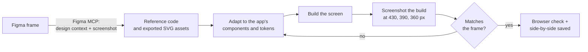

- **Tokens, not hard-coded values.** Colours and type come from the exported Figma variables (`design/figma-tokens.json`), and a test fails if they drift.
- **Assets are exports, not redraws.** Icons and illustrations are the original Figma SVGs, placed in the same slot at the same size.
- **Prototype reactions became routes.** Each frame's prototype links (`design/*-prototype-links.json`) were used to wire the tap targets. A tab bar tap goes where the prototype goes.
- **Screens keep Figma's names.** `01a Before you drive`, `C3 Warning light result` and `P5 Privacy and legal` are the component and route names, so anyone can find a screen from the file.
- **Side-by-sides are saved.** [`docs/assets/figma-vs-build`](assets/figma-vs-build) holds 20 pairs. Built-app panels use test data, so numbers differ where a screen is data-driven (for example the car report counts three items against Figma's two).
- **Live data beats sample data.** Figma's sample values (names, routes, costs) appear only in an explicit preview. Real accounts show real values, or an honest empty state.

### Where we deliberately differ from Figma

| Screen | Difference | Reason |
|---|---|---|
| Trips | "24.8 km drive" instead of "PJ → Seremban" | Trips have no place names yet. |
| Profile | Third stat is "alerts", not "breaks taken" | We do not record breaks. |
| Brake check | No "Most hard stops: Federal Highway" row | No per-road data yet. |
| Car report | Costs are typical ranges, shown only for items that need attention | We will not quote a price we cannot support. |
| Welcome | "Continue with Google" shows a message | Google sign-in is not configured. |

## 13. What I would do with another week

1. Run the tests in section 10, starting with the glance test.
2. Retrain the readiness model on real checks and events, and show the driver how their own pattern changes.
3. Add Malay copy.
4. Move the alarm and prompt choices into a settings screen that actually changes behaviour.
5. Connect a real dashboard model, test the start-up crank timing on real cars, and keep the demo labels until the team can defend the numbers.
6. Run a field pass on real phones, with iOS Safari first.
