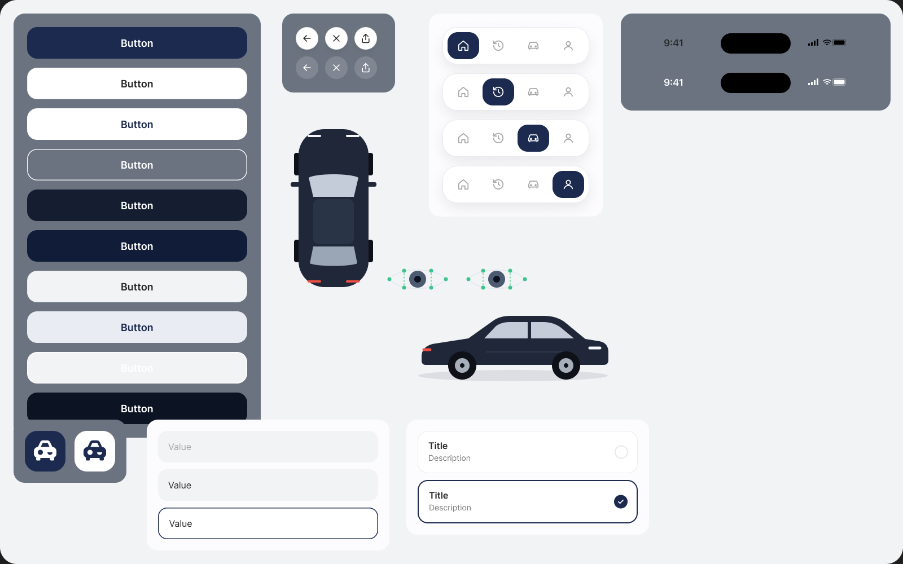
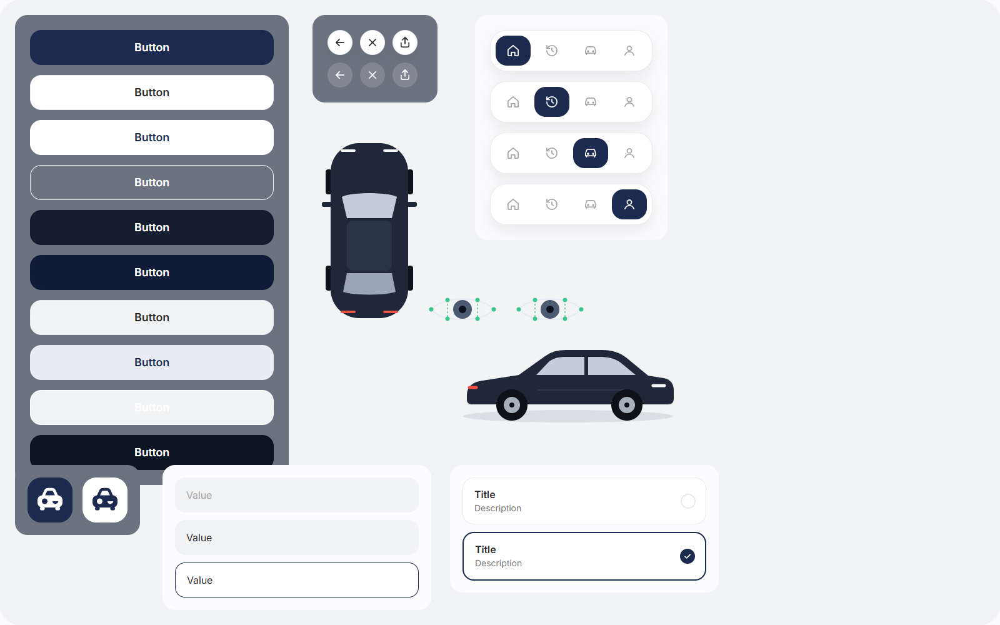
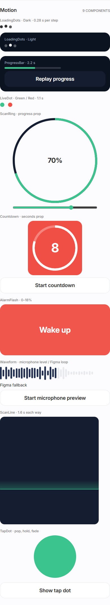

# BUCKL catch-up — 4b step 2

The approved audit is implemented through the components/motion checkpoint. Screens, navigation and driving-logic changes remain for steps 3–6.

Phone preview (on the same Wi-Fi as the development computer):

- https://172.20.10.4:5173/components
- https://172.20.10.4:5173/components#motion

## Components comparison

Current Figma frame 27:2 and the browser canvas, captured at the same 1600 × 1000 size:

| Figma | Browser |
| --- | --- |
|  |  |

Button dimensions are 390 × 56, IconButton 40 × 40 and TabBar 260 × 66. The canvas shows all ten Default/Pressed button variants. Held buttons use the Figma pressed fill and scale 0.98 over 120 ms. CarSide and CarTop positions follow the current frame. The existing input, option, tab, icon and illustration components still match their source geometry.

The browser omits the Figma iOS status-bar samples, as required by the guide. Text rasterisation differs slightly between Figma and Chromium. Exported vector artwork is used unchanged.

## Motion

All nine components are exported from the shared component index: LoadingDots, ProgressBar, LiveDot, ScanRing, Countdown, AlarmFlash, Waveform, ScanLine and TapDot. They use the shared easing and guide timings. ScanRing and Countdown receive progress/seconds as props; the gallery provides interactive controls. Reduced-motion settings replace movement with fades, including when the setting changes while the page is open.

The Figma Motion frame uses component prototype loops rather than keyframe tracks. The implementation translates these variants into Framer Motion. The rings and tap artwork use downloaded SVG layers. The reference frame overlaps and clips some variants; the gallery displays individual components so they can be exercised.

Waveform accepts the recorder's existing MediaStream and reads RMS loudness with a Web Audio AnalyserNode. It does not request permission, record, upload, play audio or stop the recorder's stream. The gallery owns a separate, explicitly started microphone preview and releases it on stop/navigation. Without microphone input the bars follow the Figma loop. Connecting this component to the battery-check recorder remains part of the screen update.

## Verification

- `npm run build`: TypeScript, production build and offline asset manifest passed. Vite retains its existing large-chunk warning.
- `npm test`: 23 tests passed, including microphone sampling and cleanup tests.
- `node scripts/browser-review.mjs --motion`: passed button states, geometry, loops, countdown, tap response/expiry, alarm opacity, microphone analysis, silence/loud input, permission denial, late permission cleanup, reduced-motion changes and 360/390/430 px widths. No runtime exceptions.
- `node scripts/browser-review.mjs`: existing gallery controls, anchors, push/fade/tab routes, back navigation, sheet scroll retention, footer spacing, fonts and SVGs passed.
- HTTPS Vite `/components`: returned HTTP 200 using the generated development certificate for verification.

[Motion verification](catch-up-motion-verification.json) and [gallery verification](browser-verification.json) contain the measured results. Browser microphone checks use Chromium's fake capture device and controlled analyser samples; physical-phone microphone/camera testing has not been performed at this checkpoint.

No dependencies were added. No backend, emergency messaging or driving logic was changed during this step.
